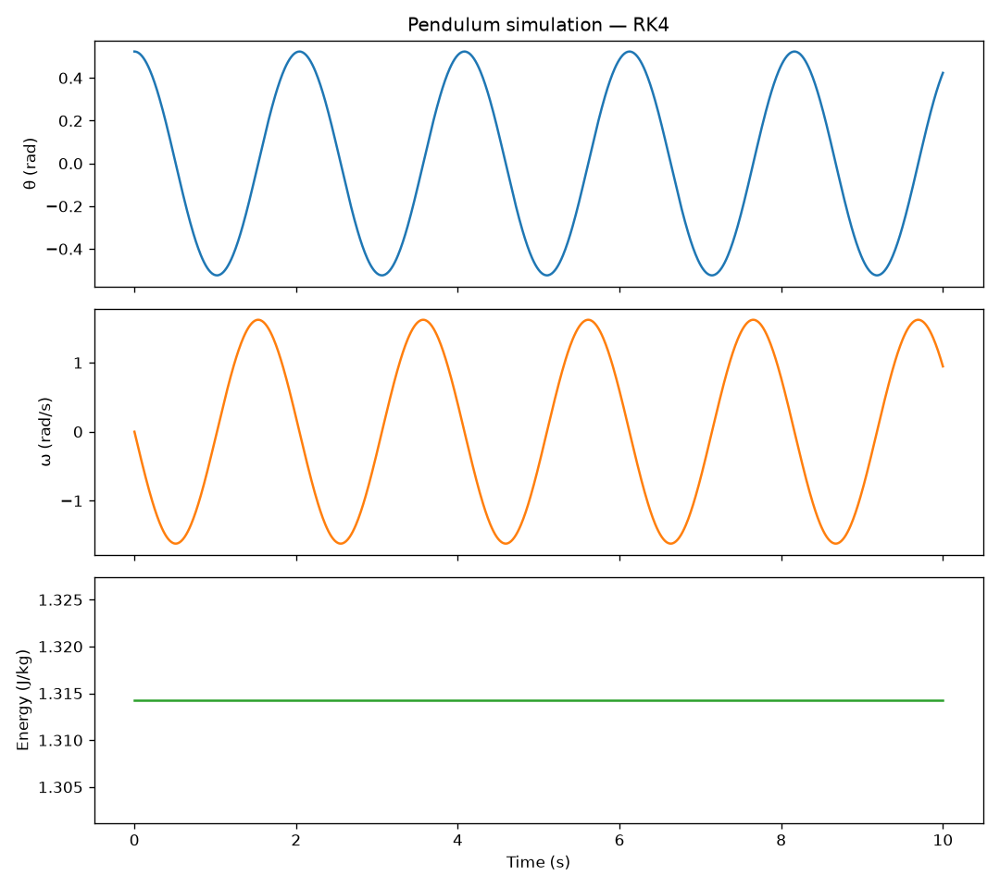

# AI Course Projects: Mechanistic Modeling

This repository contains implementations of Artificial Intelligence course projects, focusing on foundational concepts ranging from **Mechanistic Models** to **Search Algorithms**.

Currently, this repository includes:
- **Mechanistic Modeling:** Simulation of a simple pendulum using numerical integration (RK4) and energy conservation analysis.

---

## 🧠 Background: Data-Driven vs. Mechanistic Models

In the context of AI and system modeling, there are two primary paradigms for understanding and predicting system behavior:

1. **Data-Driven Models (Black-Box):** 
   These models learn patterns directly from data without explicit knowledge of the underlying physics or rules. Machine Learning algorithms (e.g., Neural Networks, Regression) fall into this category. They require large datasets and are great for complex, unknown systems, but they lack interpretability and can fail outside their training distribution.

2. **Mechanistic Models (White-Box):**
   These models rely on explicit mathematical equations derived from first principles (e.g., Newton's laws, thermodynamics). They are entirely interpretable, require no training data, and generalize perfectly within their assumptions. 
   *This project implements a mechanistic model.*

In modern AI (like Physics-Informed Neural Networks - PINNs), these two approaches are often combined to get the best of both worlds.

---

## 🎯 Project 1: Simple Pendulum Simulation

This project simulates the non-linear dynamics of a simple pendulum. Because the equation of motion for a large-angle pendulum has no closed-form analytical solution, we use **numerical integration** (specifically the 4th-order Runge-Kutta method) to predict the system's future state.

### 📐 The Physics (Mechanistic Model)
The equation of motion for a simple pendulum is derived from Newton's Second Law for rotation:
\[
 \ddot{\theta} = -\frac{g}{L} \sin(\theta) - c\dot{\theta} 
\]
Where:
- \(\theta\) is the angular displacement
- \(g\) is gravity
- \(L\) is the pendulum length
- \(c\) is the damping coefficient

To solve this computationally, we convert the 2nd-order ODE into a system of two 1st-order ODEs (**State-Space Form**):
\[
 \begin{cases} \dot{\theta} = \omega \\ \dot{\omega} = -\frac{g}{L} \sin(\theta) - c\omega \end{cases} 
\]

### ⚙️ The Algorithm (RK4)
We use the **Runge-Kutta 4th Order (RK4)** method. It evaluates the derivative at four different points within a single time step (\(dt\)) and takes a weighted average. This provides much higher accuracy and better energy conservation compared to the simple Euler method.

### 📊 Results

Below is the output of the simulation for an initial angle of 30° over 10 seconds with **zero damping**:

<div align="center">
  
</div>

**What to observe in the plot:**
1. **Angle (\(\theta\)) and Angular Velocity (\(\omega\)):** The pendulum oscillates in a smooth, periodic manner. Notice how the period is slightly longer than the small-angle approximation due to the non-linearity of \(\sin(\theta)\).
2. **Energy Conservation:** Since we set damping to zero (\(c=0\)), the total mechanical energy must remain constant. The bottom plot confirms this—the RK4 integrator keeps the energy drift incredibly small (near machine precision), proving the robustness of the numerical method.

---

## 🚀 How to Run

1. Clone the repository:
   ```bash
   git clone https://github.com/YOUR_USERNAME/ai-course-projects.git
   cd ai-course-projects/mechanistic-models/pendulum